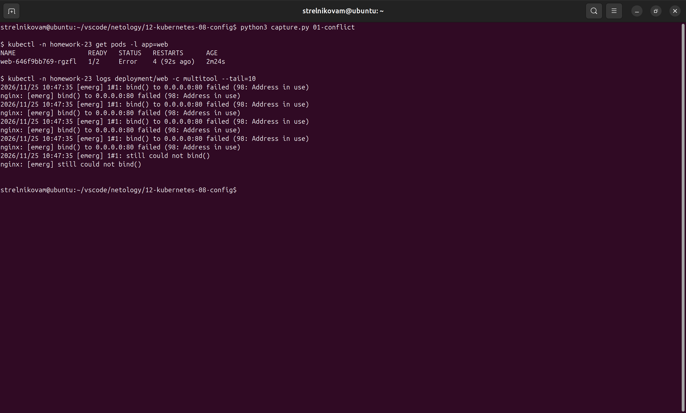
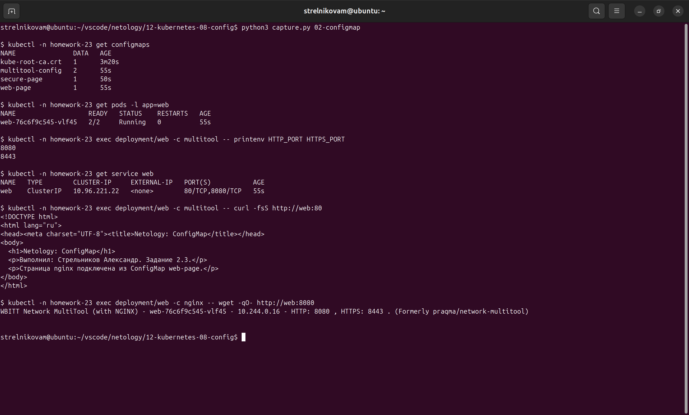
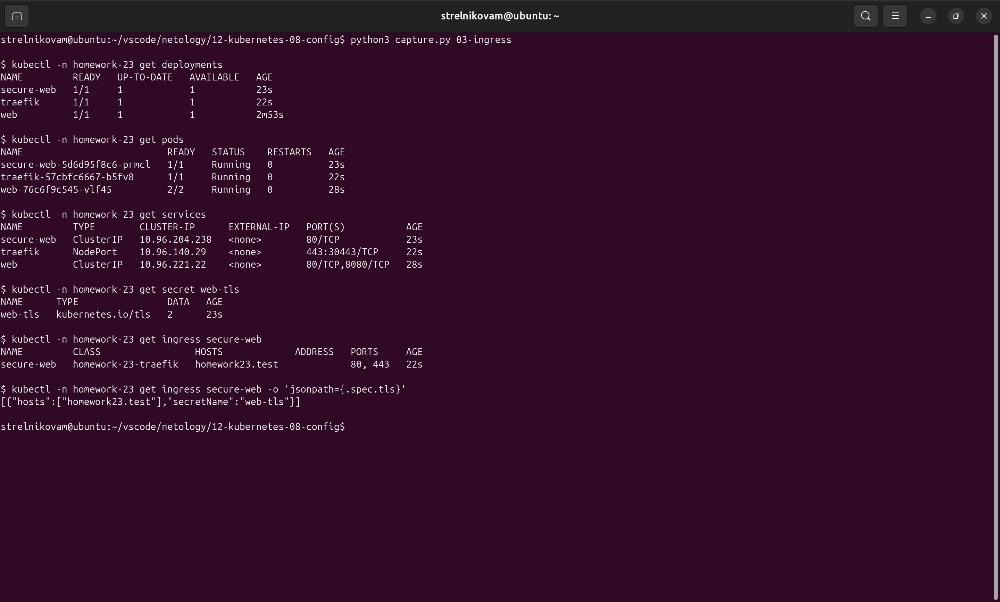
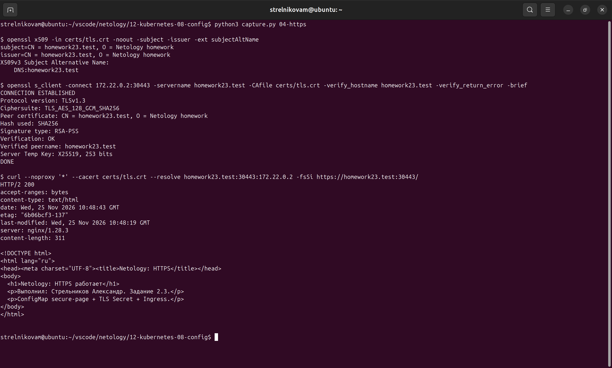
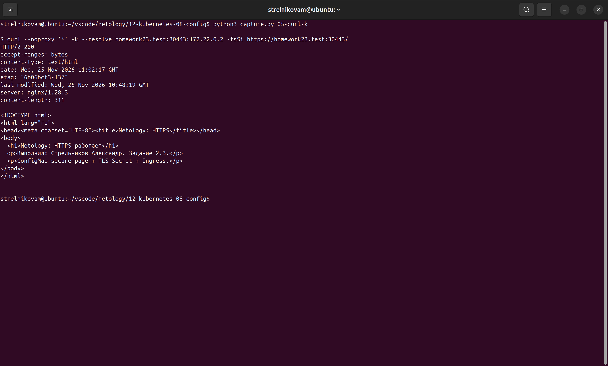
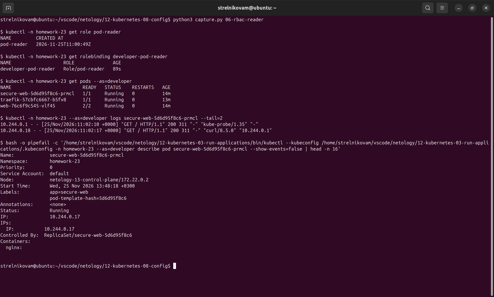
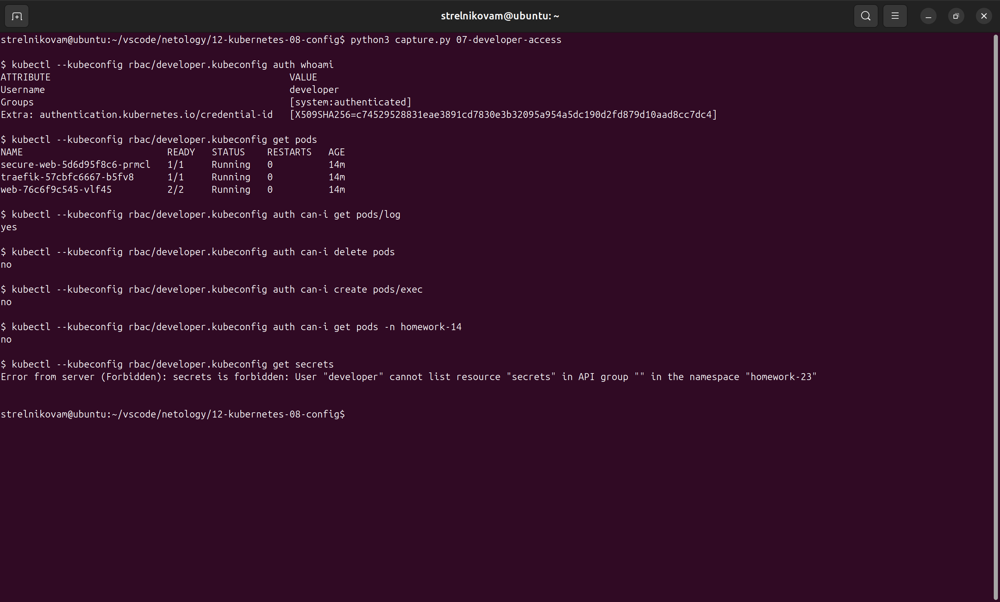

# Домашнее задание к занятию «Настройка приложений и управление доступом в Kubernetes» - Стрельников Александр

### Цель задания

Научиться:
- Настраивать конфигурацию приложений с помощью **ConfigMaps** и **Secrets**
- Управлять доступом пользователей через **RBAC**

Это задание поможет вам освоить ключевые механизмы Kubernetes для работы с конфигурацией и безопасностью. Эти навыки необходимы для уверенного администрирования кластеров в реальных проектах. На практике навыки используются для:
- Хранения чувствительных данных (Secrets)
- Гибкого управления настройками приложений (ConfigMaps) 
- Контроля доступа пользователей и сервисов (RBAC)

------

## **Задание 1: Работа с ConfigMaps**
### **Задача**
Развернуть приложение (nginx + multitool), решить проблему конфигурации через ConfigMap и подключить веб-страницу.

### **Шаги выполнения**
1. **Создать Deployment** с двумя контейнерами
   - `nginx`
   - `multitool`
3. **Подключить веб-страницу** через ConfigMap
4. **Проверить доступность**

### **Что сдать на проверку**
- Манифесты:
  - `deployment.yaml`
  - `configmap-web.yaml`
- Скриншот вывода `curl` или браузера

**Решение:**

В учебном кластере kind создал [namespace homework-23](manifests/namespace.yaml) и [Deployment с nginx и multitool](manifests/00-deployment-conflict.yaml).

При запуске возник конфликт портов: оба контейнера пытались занять порт 80 в общем сетевом пространстве Pod. В логах multitool появилась ошибка `bind() to 0.0.0.0:80 failed (98: Address in use)`, готовность Pod составила `1/2`.



Создал [ConfigMap multitool-config](manifests/configmap-web.yaml) со значениями портов:

```yaml
data:
  HTTP_PORT: "8080"
  HTTPS_PORT: "8443"
```

В [исправленном Deployment](manifests/deployment.yaml) подключил эти значения к переменным окружения multitool через `valueFrom.configMapKeyRef`. Nginx остался на порту 80, multitool запустился на 8080/8443.

Создал собственную HTML-страницу с заголовком `Netology: ConfigMap` и именем автора. Сохранил её в ключе `index.html` [ConfigMap web-page](manifests/configmap-web.yaml) и подключил к nginx томом в `/usr/share/nginx/html` только для чтения.

Создал [Service web](manifests/service.yaml) с портом 80 для nginx и 8080 для multitool. Проверил состояние Pod, значения переменных и доступ к приложениям:

```bash
kubectl -n homework-23 get configmaps
kubectl -n homework-23 get pods -l app=web
kubectl -n homework-23 exec deployment/web -c multitool -- printenv HTTP_PORT HTTPS_PORT
kubectl -n homework-23 get service web
kubectl -n homework-23 exec deployment/web -c multitool -- curl -fsS http://web:80
kubectl -n homework-23 exec deployment/web -c nginx -- wget -qO- http://web:8080
```

Pod перешёл в состояние `Running`, оба контейнера стали готовы (`2/2`). Multitool получил значения 8080 и 8443 из ConfigMap. Через Service nginx вернул созданную HTML-страницу, а multitool — страницу с именем Pod и своими портами.



---
## **Задание 2: Настройка HTTPS с Secrets**  
### **Задача**  
Развернуть приложение с доступом по HTTPS, используя самоподписанный сертификат.

### **Шаги выполнения**  
1. **Сгенерировать SSL-сертификат**
```bash
openssl req -x509 -nodes -days 365 -newkey rsa:2048 \
  -keyout tls.key -out tls.crt -subj "/CN=myapp.example.com"
```
2. **Создать Secret**
3. **Настроить Ingress**
4. **Проверить HTTPS-доступ**

### **Что сдать на проверку**  
- Манифесты:
  - `secret-tls.yaml`
  - `ingress-tls.yaml`
- Скриншот вывода `curl -k`

**Решение:**

Создал отдельный [Deployment secure-web, Service и ConfigMap secure-page](manifests/secure-app.yaml). В nginx подключил страницу с заголовком `Netology: HTTPS работает` из ConfigMap в `/usr/share/nginx/html`.

Выпустил самоподписной сертификат RSA 2048 для `homework23.test` сроком на 365 дней с именем домена в SAN:

```bash
openssl req -x509 -nodes -newkey rsa:2048 -days 365 \
  -keyout certs/tls.key -out certs/tls.crt \
  -subj '/CN=homework23.test/O=Netology homework' \
  -addext 'subjectAltName=DNS:homework23.test'
```

На основе сертификата и ключа создал [учебный Secret web-tls](manifests/secret-tls.yaml) типа `kubernetes.io/tls`. Публичный сертификат сохранён в [certs/tls.crt](certs/tls.crt).

Развернул [Ingress-контроллер Traefik и его Service](manifests/ingress-controller.yaml). HTTPS-порт контроллера опубликовал через NodePort 30443.

Создал [Ingress secure-web](manifests/ingress-tls.yaml) с правилом для `homework23.test`, backend Service `secure-web:80` и ссылкой на Secret `web-tls` в `spec.tls`. TLS-соединение завершалось на Ingress-контроллере, от него запрос направлялся к nginx по HTTP.

Проверил состояние приложений, Service, Secret и Ingress:

```bash
kubectl -n homework-23 get deployments
kubectl -n homework-23 get pods
kubectl -n homework-23 get services
kubectl -n homework-23 get secret web-tls
kubectl -n homework-23 get ingress secure-web
```

Deployment nginx и Ingress-контроллер имели готовность `1/1`. Secret содержал сертификат и ключ (`DATA=2`), Ingress был связан с доменом `homework23.test` и Secret `web-tls`.



С локального компьютера проверил сертификат и доступ по HTTPS через IP узла `172.22.0.2`:

```bash
openssl x509 -in certs/tls.crt -noout -subject -issuer -ext subjectAltName
openssl s_client -connect 172.22.0.2:30443 -servername homework23.test \
  -CAfile certs/tls.crt -verify_hostname homework23.test -verify_return_error -brief
curl --noproxy '*' --cacert certs/tls.crt \
  --resolve homework23.test:30443:172.22.0.2 \
  -fsSi https://homework23.test:30443/
```

В сертификате совпали Subject и Issuer, SAN содержал `DNS:homework23.test`. OpenSSL установил TLS 1.3 и подтвердил `Verification: OK` и `Verified peername: homework23.test`. Curl проверил сертификат через `--cacert`, получил `HTTP/2 200` и собственную страницу из ConfigMap.



Дополнительно выполнил проверку `curl -k`, указанную в условии:

```bash
curl --noproxy '*' -k --resolve homework23.test:30443:172.22.0.2 \
  -fsSi https://homework23.test:30443/
```

Получил `HTTP/2 200` и страницу из ConfigMap.



---
## **Задание 3: Настройка RBAC**  
### **Задача**  
Создать пользователя с ограниченными правами (только просмотр логов и описания подов).

### **Шаги выполнения**  
1. **Включите RBAC в microk8s**
```bash
microk8s enable rbac
```
2. **Создать SSL-сертификат для пользователя**
```bash
openssl genrsa -out developer.key 2048
openssl req -new -key developer.key -out developer.csr -subj "/CN={ИМЯ ПОЛЬЗОВАТЕЛЯ}"
openssl x509 -req -in developer.csr -CA {CA серт вашего кластера} -CAkey {CA ключ вашего кластера} -CAcreateserial -out developer.crt -days 365
```
3. **Создать Role (только просмотр логов и описания подов) и RoleBinding**
4. **Проверить доступ**

### **Что сдать на проверку**  
- Манифесты:
  - `role-pod-reader.yaml`
  - `rolebinding-developer.yaml`
- Команды генерации сертификатов
- Скриншот проверки прав (`kubectl get pods --as=developer`)

**Решение:**

В kind-кластере RBAC уже был включён: kube-apiserver запущен с `--authorization-mode=Node,RBAC`.

Создал ключ и запрос на сертификат для пользователя `developer`:

```bash
openssl genrsa -out rbac/developer.key 2048
openssl req -new -key rbac/developer.key -out rbac/developer.csr -subj '/CN=developer'
```

Передал CSR и [расширения клиентского сертификата](rbac/client.ext) на учебную ноду, подписал сертификат CA кластера внутри ноды:

```bash
docker exec netology-13-control-plane openssl x509 -req \
  -in /root/homework23/developer.csr \
  -CA /etc/kubernetes/pki/ca.crt -CAkey /etc/kubernetes/pki/ca.key \
  -CAcreateserial -CAserial /root/homework23/ca.srl \
  -out /root/homework23/developer.crt -days 365 \
  -extfile /root/homework23/client.ext
```

Полученный [developer.crt](rbac/developer.crt) использовал в отдельном kubeconfig. Приватный ключ CA остался на ноде, приватный ключ пользователя и kubeconfig исключены из Git.

Создал [Role pod-reader](manifests/role-pod-reader.yaml) и [RoleBinding developer-pod-reader](manifests/rolebinding-developer.yaml) в namespace `homework-23`. Роль разрешила `get/list/watch` для `pods` и `get` для `pods/log`. RoleBinding связал роль с пользователем `developer`.

Проверил доступ с impersonation:

```bash
kubectl -n homework-23 get pods --as=developer
kubectl -n homework-23 --as=developer logs secure-web-5d6d95f8c6-prmcl --tail=2
kubectl -n homework-23 --as=developer describe pod secure-web-5d6d95f8c6-prmcl --show-events=false
```

Список Pod, их логи и описание были доступны. Для `kubectl describe pod` достаточно права `get` на Pod; `describe` не является отдельным API-действием. Описание проверил без событий, поскольку права на ресурс `events` роли не выдавались.



Затем подключился с клиентским сертификатом через отдельный kubeconfig и проверил разрешённые и запрещённые действия:

```bash
kubectl --kubeconfig rbac/developer.kubeconfig auth whoami
kubectl --kubeconfig rbac/developer.kubeconfig get pods
kubectl --kubeconfig rbac/developer.kubeconfig auth can-i get pods/log
kubectl --kubeconfig rbac/developer.kubeconfig auth can-i delete pods
kubectl --kubeconfig rbac/developer.kubeconfig auth can-i create pods/exec
kubectl --kubeconfig rbac/developer.kubeconfig auth can-i get pods -n homework-14
kubectl --kubeconfig rbac/developer.kubeconfig get secrets
```

Сервер определил пользователя как `developer`. Список Pod и чтение логов были разрешены. Удаление Pod, запуск команд в контейнерах и чтение Pod в другом namespace получили `no`; запрос Secrets завершился `Forbidden`.



---